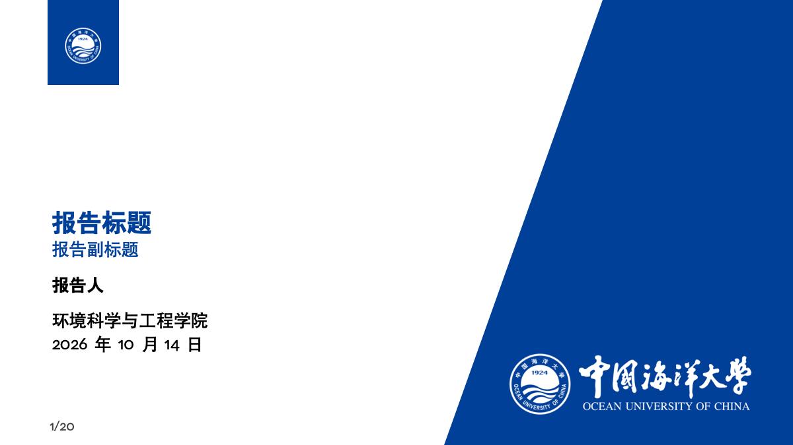
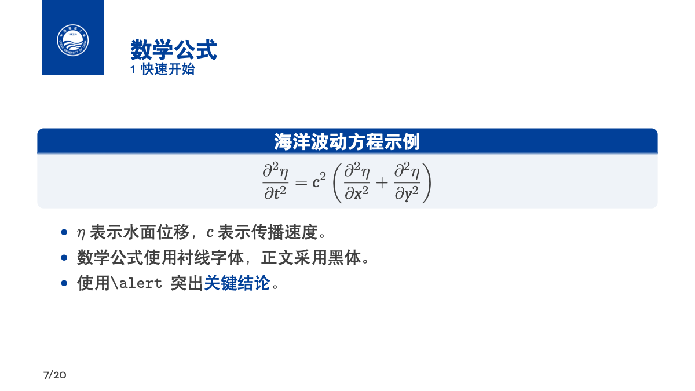

# 中国海洋大学 Beamer 模板（OUC Beamer Template）

本项目基于 Wenhao Fang 发布于 Overleaf 的 **[清华中文模版 THU-Beamer-Template](https://www.overleaf.com/latex/templates/qing-hua-zhong-wen-mo-ban-thu-beamer-template/rqcttdtynxky)** 改编，将配色、校徽和中英文校名调整为中国海洋大学版本，并优化了中文排版、封面信息布局及 VS Code 编译配置。

原模板链接：[Overleaf · 清华中文模版 THU-Beamer-Template](https://www.overleaf.com/latex/templates/qing-hua-zhong-wen-mo-ban-thu-beamer-template/rqcttdtynxky)。原项目仓库：[FangWHao/THU-beamer-template](https://github.com/FangWHao/THU-beamer-template)。

适用于学术报告、课程汇报、开题报告和毕业答辩。主色取自所提供的海大参考校徽：**RGB(1, 64, 153) / HEX `#014099`**。

## 目录

- [功能特点](#功能特点)
- [效果预览](#效果预览)
- [快速开始](#快速开始)
- [自定义设置](#自定义设置)
- [项目结构](#项目结构)
- [图片资源](#图片资源)
- [来源与致谢](#来源与致谢)
- [许可说明](#许可说明)

## 功能特点

- 16:9 页面比例，提供斜分割封面、普通正文页、章节页、侧图页和结束页。
- 使用海大蓝配色，以及中国海洋大学校徽和中英文校名组合。
- 支持中文与数学公式，使用 TeX Live / MacTeX 提供的 Fandol 中文字体。
- 封面的报告标题位于页面垂直中央，报告人上下保留约半行留白，学院信息位于日期上方。
- 按章节自动生成目录页，标题区仅显示“目录”。
- 附带 VS Code / LaTeX Workshop 配置，固定输出为 `ouc-beamer-template.pdf`，编译成功后自动清理辅助文件。

## 效果预览

### 封面



### 目录


### 正文



完整示例：[ouc-beamer-template.pdf](ouc-beamer-template.pdf)。

## 快速开始

### 1. 获取模板

下载仓库 ZIP 并解压，或使用 Git 克隆本仓库。建议为每个新汇报复制一份完整的模板文件夹，保留原模板作为后续使用的起点。

### 2. 准备编译环境

使用 **XeLaTeX** 编译。请安装包含 Beamer、xeCJK、Fandol、Carlito、Caladea 和 latexmk 的 TeX 发行版，例如 macOS 上的 MacTeX 或 TeX Live。

### 3. 修改汇报内容

打开 [`beamersapienza.tex`](beamersapienza.tex)，修改导言区的封面信息，以及 `\begin{document}` 和 `\end{document}` 之间的幻灯片内容。

```tex
\title{报告标题}
\subtitle{报告副标题}
\author{报告人}
\institute{环境科学与工程学院}
\date{\number\year 年\number\month 月\number\day 日}
```

`\institute{...}` 设置封面的子单位。各个汇报使用独立文件夹时，同名 PDF 不会互相覆盖。

### 4. 编译

#### VS Code

1. 安装 **LaTeX Workshop** 扩展。
2. 使用 VS Code 打开整个项目文件夹，使 [`.vscode/settings.json`](.vscode/settings.json) 生效。
3. 打开 `beamersapienza.tex`，运行 **Build LaTeX project**。

项目配置使用 latexmk 调用 XeLaTeX，自动完成目录和总页数所需的多轮编译，输出 `ouc-beamer-template.pdf`。编译成功后清理日志和辅助文件；编译失败时保留日志。

配置中的编译命令为 MacTeX 路径 `/Library/TeX/texbin/latexmk`。在其他系统上使用时，请将 `latex-workshop.latex.tools` 中的 `command` 改为 `latexmk` 或本机的实际路径。

自动清理使用 `latex-workshop.latex.autoClean.run: "onSucceeded"`，需要扩展支持这一选项。当前配置关闭 SyncTeX，编译输出仅保留 PDF，因此不提供 PDF 与源码之间的双向跳转。

#### 命令行

在项目根目录执行：

```sh
latexmk -xelatex -jobname=ouc-beamer-template beamersapienza.tex
```

如果不使用 latexmk，可运行 XeLaTeX 两次以更新目录和总页数：

```sh
xelatex -jobname=ouc-beamer-template beamersapienza.tex
xelatex -jobname=ouc-beamer-template beamersapienza.tex
```

命令行编译不触发 LaTeX Workshop 的自动清理设置。

#### TeXShop / Overleaf

- **TeXShop**：选择 XeLaTeX 编译。
- **Overleaf**：上传主文件、两个 `.sty` 文件及 `assets` 文件夹，将主文件设为 `beamersapienza.tex`，编译器选择 XeLaTeX。

## 自定义设置

### 页面样式与封面背景

在导言区设置：

```tex
\usetheme{sintef} % 保留上游接口，实际加载海大版本主题
\themecolor{white} % 白底正文；main 为海大蓝底白字
\titlebackground*{assets/background.png}
```

`\titlebackground*{...}` 使用右侧斜分割封面。主题和颜色文件保留原有名称，以兼容上游使用方式。

### 配色与页脚

主色定义位于 [`sintefcolor.sty`](sintefcolor.sty)：

```tex
\definecolor{oucblue}{RGB}{1,64,153}
\colorlet{maincolor}{oucblue}
```

`ouclightblue`、`oucdarkblue`、`oucgrey`、`ouccyan`、`oucgold` 为图表和排版辅助色，不代表学校官方标准色。

```tex
\footlinecolor{oucblue} % 蓝色页脚，显示页码、报告人和标题
\footlinecolor{}        % 无色页脚，仅保留页码
\footlinepayoff{自定义页脚文字}
```

### 特殊页面

```tex
% 章节页：空的颜色参数表示使用默认海大蓝
\begin{chapter}[assets/background_negative.png]{}{章节标题}
  本章节的主要内容
\end{chapter}

% 侧图页
\begin{sidepic}{assets/background.png}{页面标题}
  左侧正文内容
\end{sidepic}

% 结束页
\backmatter
% 或 \backmatter[notitle]，隐藏结束页的报告标题
```

## 项目结构

```text
OUC-beamer-template/
├── README.md
├── beamersapienza.tex          # 主文件与使用示例
├── beamerthemesintef.sty       # 海大版主题
├── sintefcolor.sty             # 主色及辅助配色
├── ouc-beamer-template.pdf     # 编译后的示例
├── .vscode/
│   └── settings.json          # 编译、命名与自动清理设置
├── assets/                    # 成品图片、参考图及旧版素材
├── demo/                      # README 预览图片
└── scripts/
    └── prepare_assets.py      # 从参考图制作成品图片
```

## 图片资源

### 模板使用的图片

| 文件 | 像素尺寸 | DPI | 内容 |
| --- | --- | --- | --- |
| `assets/background.png` | 2960 × 2160 | 300 | 海大蓝底，白色校徽与中英文校名 |
| `assets/background_negative.png` | 2960 × 2160 | 300 | 白底，蓝色校徽与中英文校名 |
| `assets/logo_RGB.png` | 1865 × 2220 | 72 | 白底蓝色校徽，对应 `reference_logo_RGB.png` |
| `assets/logo_RGB_negative.png` | 1865 × 2220 | 72 | 蓝底白色校徽，对应 `reference_logo_RGB_negative.png` |

`assets/reference_*` 为海大参考素材，`assets/old_*` 为旧版素材，仅用于制作和对照，不参与模板编译。

### 重新制作图片

正常使用模板无需执行图片制作脚本。需要重新生成素材时，安装 Python 3 与 Pillow 后运行：

```sh
python3 -m pip install Pillow
python3 scripts/prepare_assets.py
```

脚本会覆盖上述四张成品图片。它裁除参考图外围的透明留白，将标识等比缩放到旧版的范围与位置，保留轮廓和抗锯齿边缘，不重绘或拉伸校徽与文字。

主色从参考校徽的不透明像素中提取。更换参考图后，如果蓝色发生变化，请同步更新 `sintefcolor.sty` 中的 `oucblue` 定义。

PNG 使用整数像素／米存储 DPI，读取时可能显示约 299.9994 或 72.009，分别对应 300 DPI 和 72 DPI。

## 来源与致谢

本项目的直接来源是 Wenhao Fang 的 **[清华中文模版 THU-Beamer-Template](https://www.overleaf.com/latex/templates/qing-hua-zhong-wen-mo-ban-thu-beamer-template/rqcttdtynxky)**。原模板页面说明其由北京大学 Beamer 模板改编。

同时感谢上游模板与主题的贡献者：

- Federico Zenith：[SINTEF Presentation](https://www.overleaf.com/latex/templates/sintef-presentation/jhbhdffczpnx)。
- Liu Qilong：[Beamer-LaTeX-Themes](https://github.com/TOB-KNPOB/Beamer-LaTeX-Themes)。
- Andrea Gasparini：Sapienza 版本的主题改编。
- Wenhao Fang：[THU-beamer-template](https://github.com/FangWHao/THU-beamer-template)。

本项目在这些工作的基础上调整海大配色与标识、中文示例、封面排版、目录页及编译配置。海大标识来源于项目提供的参考图片。

## 许可说明

本项目模板代码采用 **[GNU General Public License v3.0](LICENSE)**，与原作者 GitHub 仓库的许可一致。`beamerthemesintef.sty` 保留其上游“GNU GPL v3 或更新版本”的声明。使用或再发布时，请保留相应文件中的版权、来源和许可信息。

原 Overleaf 展示页面标注 **Creative Commons CC BY 4.0**，与其链接的源代码仓库存在差异；本项目继承的模板代码沿用源代码仓库及文件中的 GPL 声明。

中国海洋大学校徽与校名标识的权利归其权利人所有，其使用不由模板代码许可授予。
